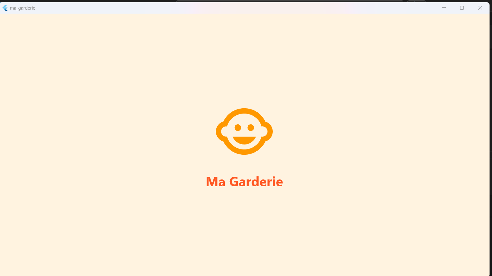
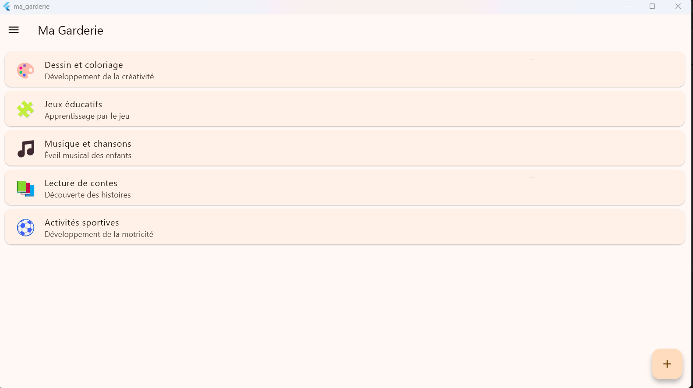
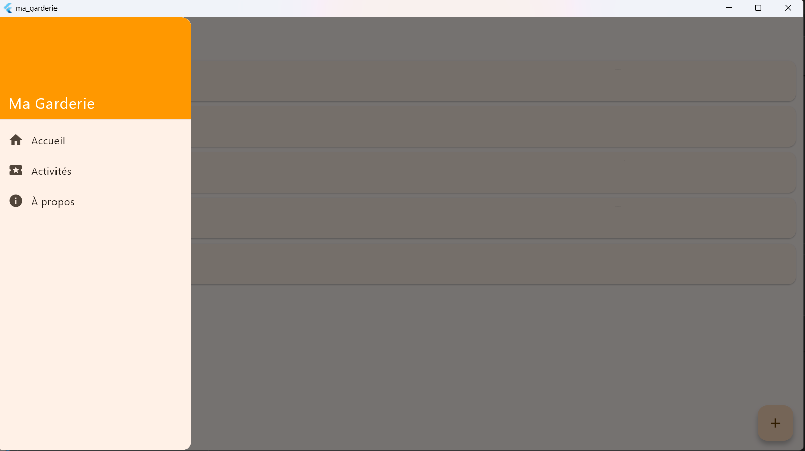
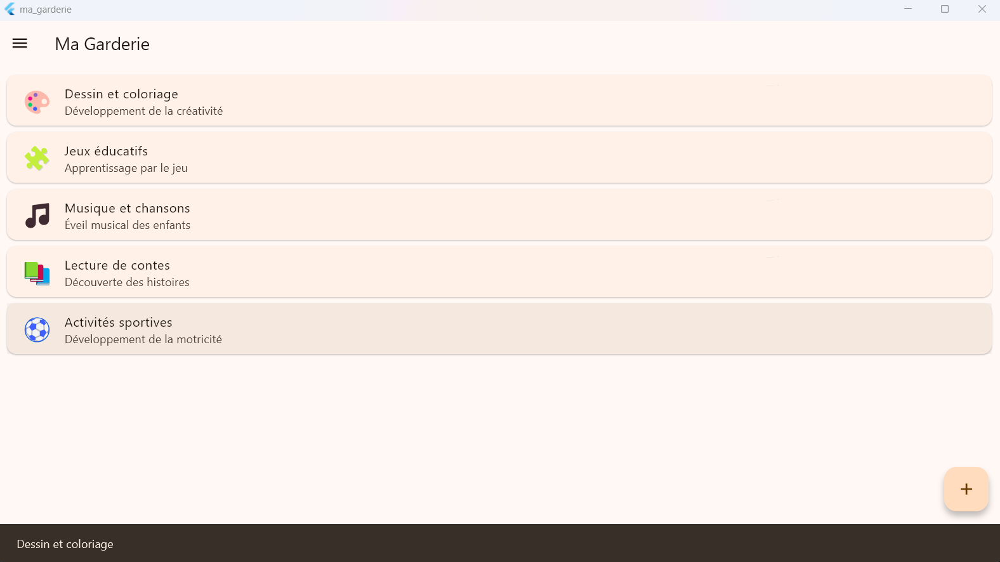

# Ma Garderie

Application mobile de démonstration pour une garderie d'enfants.

## Technologies utilisées

- Flutter (Dart)
- Git et GitHub

## Installation

```bash
git clone https://github.com/mounawerzarai/garderie-mobile.git
cd garderie-mobile
flutter pub get
```

## Exécution

```bash
flutter run
```

Par exemple, sous Windows : `flutter run -d windows`

## Captures d'écran

### Splash Screen



### Page principale avec la liste des activités



### Drawer ouvert (le menu à gauche)



### Message affiché après une interaction

Lorsqu'on clique sur une activité, son titre s'affiche en bas de l'écran.

